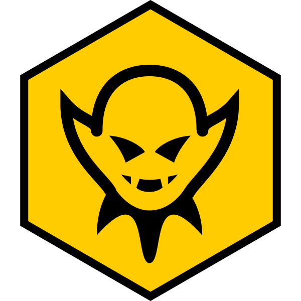
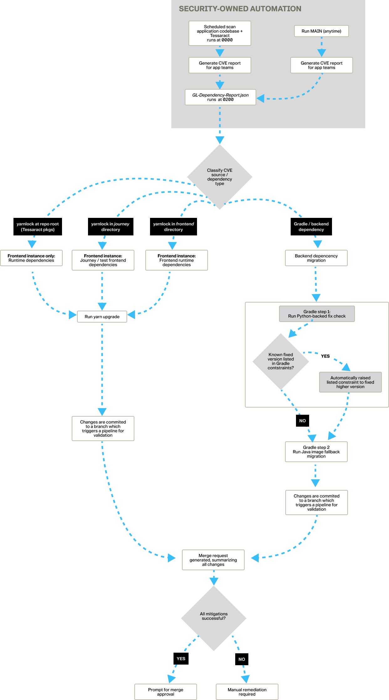
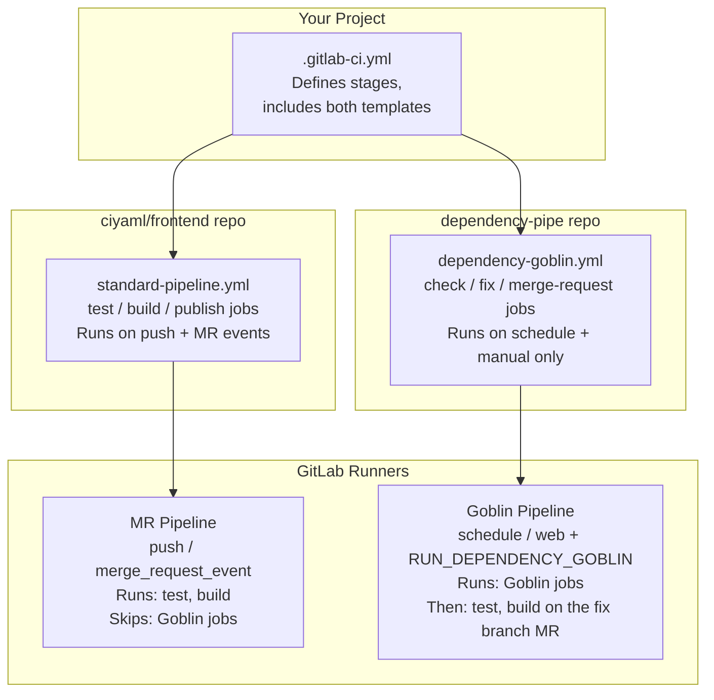

#  DependencyGoblin

> *Automatically finds vulnerable dependencies, upgrades them, and opens a merge request for your review, while you sleep.*

---

## At a Glance

| | |
|---|---|
| **Type** | Automated GitLab CI pipeline |
| **Schedule** | Nightly at 0200 CDT[^1] |
| **Purpose** | Mitigate dependency CVEs before your team starts work, so no vulnerability sits unaddressed for weeks |
| **Output** | One Merge Request per run, containing every fix, for a human to review and approve |
| **Support** | Team 4-1 (War.lock) |

When a vulnerability is found in a package your project depends on, DependencyGoblin upgrades it to the minimum safe version, regenerates the lock files, verifies the project still lints, builds and passes its tests, then opens a Merge Request.

[^1]: In other time zones the job runs at `0 7 * * *` UTC. The schedule does not adjust for daylight saving time.

---

## Who This Is For

This document is written for Software Engineers. PMs and PDs rarely interact with the pipeline directly.

- When a vulnerability is fixed, the assigned engineer receives a GitLab Merge Request notification. The MR is labeled `fix: auto-remediate dependency vulnerabilities` and can be ignored unless you are reviewing the security posture of a release.
- You do not need to do anything to trigger the nightly run.
- To change the schedule, temporarily disable the pipeline, or request a feature (for example, a different severity filter), contact **Team 4-1 (War.lock)**.

---

## Quick Reference: What Do I Do When...

| Situation | Action |
|---|---|
| A Goblin MR arrived | [Review and merge it](#what-to-do-when-you-receive-a-goblin-mr) |
| The nightly run did not fix a CVE | [Add a resolution and run Goblin manually](#when-the-nightly-run-does-not-fix-a-vulnerability) |
| I want to run Goblin now (new CVE, onboarding a project) | [Run it manually](#running-it-manually) |
| The Goblin pipeline itself is failing | Contact Team 4-1 |
| I need a different schedule or severity filter | Contact Team 4-1 |

---

## Running It Manually

Run DependencyGoblin outside the nightly schedule after learning about a new CVE, when onboarding a new project, or after adding a resolution (see the next section).

1. Navigate to your project in GitLab.
2. Go to **Build → Pipelines**.
3. Click **New pipeline** (top right).
4. In the **Branch or tag** dropdown, select the branch to run against. The default is `main`; see [Choosing the Branch](#choosing-the-branch).
5. Under **Inputs**, add:
   - Key: `RUN_DEPENDENCY_GOBLIN`[^2]
   - Value: `true`
6. Click **New pipeline** to start the run.

[^2]: **Important:** Without `RUN_DEPENDENCY_GOBLIN=true`, a manually triggered pipeline runs your normal test and build jobs but skips DependencyGoblin. The variable is the on-switch.

### Choosing the Branch

DependencyGoblin works from **the branch the pipeline runs against**, not always `main`:

- The fix branch is created from that branch, so Goblin reads the `package.json`, `build.gradle` and lock files as they exist **on that branch**, including any edits you made there.
- The Merge Request targets that same branch.
- The nightly schedule runs against `main`, so its behavior is unchanged.

---

## When the Nightly Run Does Not Fix a Vulnerability

Sometimes the nightly run completes but a CVE remains in the Vulnerability Report. Typical causes are a fix that requires a major version bump outside the range pinned in `package.json`, a transitive dependency, or an advisory the Goblin skipped (see [What DependencyGoblin Cannot Fix Automatically](#what-dependencygoblin-cannot-fix-automatically)).

You do not need to pull the project down and fix it locally. Add a **resolution** (a version override) in the GitLab web UI, then let the Goblin do the heavy lifting. It pulls in the new dependencies, rebuilds the lock files, and runs your lint, build and test jobs on the result.

### Step 1: Create a branch and add the resolution

Create a working branch from `main` (for example `fix/cve-resolution` or continue using the branch created by the scheduled Dependency Goblin run `auto-fix-vuln-remediation-*`), then edit the file that fits your dependency, using **Repository → Files → Edit** (or **Edit in Web IDE**).

| Ecosystem | Where to add the resolution | Notes |
|---|---|---|
| **Gradle (preferred)** | The `ASWF-Dependency-Platform` | Fixes the version once for every project that consumes the platform. Merge and publish the platform change, then make sure your project picks up the new platform version on your working branch. |
| **Gradle (project-only)** | `build.gradle` in your project | Use when the fix is specific to your project. Follow the same `version { require "..." }` format the Goblin already patches. |
| **Yarn** | `resolutions` in `package.json` (`package.json`, `frontend/package.json` or `journey/package.json`) | Forces a version, including for transitive dependencies. |

Gradle Platform example:

```groovy
api("io.netty:netty-codec-http"){
    version{
        strictly "[4.1.137.Final,4.2.19.Final]"
        prefer "4.2.19.Final"
    }
    because "Versions before are affected by CVE-2026-59903"
}
```

Yarn example:

```json
{
  "resolutions": {
    "vulnerable-package": "^2.4.1"
  }
}
```

Gradle example (`build.gradle`):

```groovy
implementation('io.netty:netty-codec') {
    version {
        require "4.2.19.Final"
    }
    because "Versions before are affected by CVE-2026-59903"
}
```

Use the fixed version named in the vulnerability's **Solution** field in the GitLab Vulnerability Report.

### Step 2: Run the Goblin on your branch

Follow [Running It Manually](#running-it-manually) and select your working branch in the **Branch or tag** dropdown, with `RUN_DEPENDENCY_GOBLIN=true`.

### Step 3: Review the result

The Goblin:

1. Reads your branch, including the resolution you added.
2. Upgrades dependencies and regenerates `yarn.lock` and `gradle.lockfile`.
3. Opens an MR **into your working branch**.
4. Runs your standard lint, build and test jobs on the MR.

Review the diff, confirm the pipeline is green, and merge the MR into your working branch. Then open a normal MR from your working branch to `main`.

### Notes

- If the Goblin MR pipeline fails, the resolution likely introduced a breaking change. Adjust the version or the code on your working branch and run the Goblin again.
- The vulnerability list the Goblin acts on still comes from the latest scan report on `main`; see [How Vulnerabilities Are Detected](#how-vulnerabilities-are-detected). A resolution you add by hand is applied whether or not the scan report lists that package.
- Once your change is merged to `main`, the next dependency scan should show the CVE as resolved.

---

## What Happens When It Runs

The pipeline runs through five stages in sequence. Each stage must pass before the next begins.



> If any stage fails, the pipeline stops and later stages do not run. No MR is opened from a failed run. The GitLab pipeline view shows which stage failed, and the job log contains the full error.

Fix commits are GPG-signed, so they display as **Verified** in GitLab.

---

## How Vulnerabilities Are Detected

DependencyGoblin does **not** run the vulnerability scan itself. GitLab's built-in **Dependency Scanning** job runs separately on a schedule in each project and produces `gl-dependency-scanning-report.json`. DependencyGoblin reads that existing report from `main`.

This means:

- DependencyGoblin is only as current as the most recent scan report on `main`.
- If the dependency scanning job has not run recently, the Goblin works from an older report.
- The two schedules are intentionally separate, so the scan and the fix run independently.

### Severity Levels

| Severity | Processed | Notes |
|----------|-----------|-------|
| Critical | Yes | |
| High | Yes | |
| Medium | Yes | |
| Low | Yes | |
| Unknown | No | Unscored advisories, not actionable |
| Info | No | Informational notices only |

To change this filter (for example, to process only Critical and High), submit a feature request to Team 4-1 (War.lock). The filter is the `target_severities` set in `check:vulnerabilities`.

---

## How Frontend Dependencies Are Upgraded (Yarn)

DependencyGoblin detects which `yarn.lock` files contain vulnerable packages by reading the `location.file` field in the scan report. It checks three locations:

| Lockfile | Flag set |
|----------|----------|
| `yarn.lock` (repo root) | `FIX_FRONTEND_PACKAGE` |
| `frontend/yarn.lock` | `FIX_FRONTEND` |
| `journey/yarn.lock` | `FIX_JOURNEY` |

For each affected lockfile, DependencyGoblin runs `yarn upgrade` in that directory. Yarn resolves the latest version of every package that satisfies the range declared in `package.json` and rewrites `yarn.lock`.

**In practice:**

- `yarn upgrade` stays within the constraints of `package.json`. A package pinned to `"^1.2.3"` upgrades to the latest `1.x` release but not to `2.0.0`. A major bump needs a change to `package.json` first, such as a [resolution](#when-the-nightly-run-does-not-fix-a-vulnerability).
- All packages with available updates in the affected lockfile are upgraded, not just the vulnerable one. This is intentional: it reduces how often upgrade MRs appear and keeps the lockfile current.
- If `yarn upgrade` cannot resolve a version (for example, a conflicting peer dependency), the job fails and no commit is made. The pipeline stops cleanly and no broken code reaches the MR.

DependencyGoblin commits `yarn.lock` and `package.json` with a message like:

```
fix(frontend): auto-upgrade yarn dependencies
```

---

## How Backend Dependencies Are Upgraded (Gradle)

Gradle remediation is more surgical than the Yarn approach, because `build.gradle` declares version numbers explicitly rather than leaving them to a lockfile manager. It runs as two jobs.

### Job 1: `fix-backend-python` (patch `build.gradle`)

For each vulnerable Gradle dependency, DependencyGoblin:

1. Reads the **currently installed version** from the `dependency.version` field.
2. Parses the **target fix version** from the free-text `solution` field of the advisory.

#### Version Selection Logic

The advisory may list a single version, or one fix version per maintained release branch:

```
"Upgrade to version 4.1.133.Final or above."
"Upgrade to versions 6.4.2, 7.3.2, 8.0.5 or above."
```

When several versions are listed, DependencyGoblin selects the **minimum version strictly greater than the one installed**, which keeps upgrades on the same major/minor line wherever possible.

```
Installed:  7.1.0
Candidates: 6.4.2, 7.3.2, 8.0.5
Discarded:  6.4.2  (less than installed, would be a downgrade)
Remaining:  7.3.2, 8.0.5
Selected:   7.3.2  (minimum of remaining, stays in the 7.x line)
```

DependencyGoblin then generates a patch script that uses a multiline regex to find the dependency block in `build.gradle` and replace only the version string:

```groovy
// Before
implementation('io.netty:netty-codec') {
    version {
        require "4.2.17.Final"
    }
}

// After
implementation('io.netty:netty-codec') {
    version {
        require "4.2.19.Final"
    }
}
```

The patch is scoped to the exact package name, so no other dependency in the file is touched.

> **Why not `./gradlew --refresh-dependencies`?** That command re-resolves dependencies against the registry but does not change the constraints in `build.gradle`. If `build.gradle` says `require "4.2.17.Final"`, Gradle keeps resolving that version. The version string must be changed first.

### Job 2: `fix-backend-gradle` (regenerate `gradle.lockfile`)

After `build.gradle` is patched, a second job on the JDK image runs:

```bash
./gradlew dependencies --write-locks
```

This deletes the existing `gradle.lockfile` and regenerates it from scratch against the patched `build.gradle`, so no stale entries from old resolutions are carried forward.

Both the patched `build.gradle` and the new `gradle.lockfile` are committed to the fix branch.

---

## The Fix Branch

All commits from the fix jobs go to a single branch:

```
auto-fix-vuln-remediation-{PIPELINE_ID}
```

The pipeline ID keeps two overlapping Goblin runs (for example, a manual trigger during a nightly run) from colliding.

The fix branch is created from the branch the pipeline ran against: `main` for the nightly run, or your working branch for a manual run (see [Choosing the Branch](#choosing-the-branch)).

When `create:merge-request` runs, it first deletes any **stale** `auto-fix-vuln-remediation-*` branches from earlier pipelines (for example, a run that failed before creating its MR). Branches that do not match the current pipeline ID are removed on a best-effort basis before the MR is created.

---

## The Merge Request

When all fix jobs succeed, DependencyGoblin opens a Merge Request into the branch the pipeline ran against (`main` for nightly runs). The MR is assigned to the user in the `ASSIGNEE_USER_ID` CI variable and labeled `security`, `automated` and `dependencies`.

The description is generated dynamically and lists exactly what changed:

```
## Automated Vulnerability Remediation

This MR was automatically created by pipeline #12345 after the daily
dependency scan detected CVEs.

### Changes
- `frontend/yarn.lock` — upgraded via `yarn upgrade`
- `build.gradle` + `gradle.lockfile` — patched and regenerated

### Validation
- Lint passed (inline with upgrade)
- Build passed
- Tests passed

Please review the dependency diff before merging.
```

### What to Do When You Receive a Goblin MR

1. **Review the diff.** Changes should be limited to lock files (`yarn.lock`, `gradle.lockfile`) and occasionally `build.gradle` and `package.json`. You should not see application code changes.
2. **Check the pipeline.** The MR triggers your standard test and build pipeline. Confirm it is green before merging.
3. **Merge or close.** If the pipeline is green and the diff looks correct, merge it. If something looks wrong, close the MR and investigate. The Goblin opens a new one on the next run once the underlying issue is resolved.
4. **Confirm in the Vulnerability Report.** After merging, the next dependency scan should show the CVEs as resolved under **Secure → Vulnerability Report**.

> **Do not force-push or rebase the fix branch.** The fix jobs commit sequentially to the same branch. Force-pushing can make a later job fail when it references a commit that no longer exists.

---

## What DependencyGoblin Cannot Fix Automatically

In these cases the Goblin logs a warning and skips the vulnerability rather than attempt an unsafe or ambiguous fix:

| Situation | What happens | What you can do |
|---|---|---|
| Advisory has no parseable version in the solution text | Logged as `[GRADLE WARN]`, skipped | [Add a resolution](#when-the-nightly-run-does-not-fix-a-vulnerability) |
| All fix versions are lower than the installed version (vendor-patched fork) | Logged as `[VERSION WARN]`, skipped | Review manually |
| `yarn upgrade` fails on conflicting peer dependencies | Job fails, pipeline stops, no MR | [Add a resolution](#when-the-nightly-run-does-not-fix-a-vulnerability) to settle the conflict |
| The package is pinned to a major version in `package.json` and the fix needs a major bump | Upgraded to the latest safe version inside the pinned range; may not fully resolve the CVE | [Add a resolution](#when-the-nightly-run-does-not-fix-a-vulnerability) |

Skipped or unresolved vulnerabilities remain visible in the GitLab Vulnerability Report.

---

## Pipeline Architecture

The diagram shows how the DependencyGoblin pipeline file relates to the other pipeline includes in your project.



> The two included pipeline files merge into your project's `.gitlab-ci.yml`, and each pipeline source activates a different subset of jobs. MR pipelines run test and build only. The Goblin pipeline runs the fix jobs, then your test and build jobs run on the fix branch MR before you merge.

The two pipeline files **never interfere with each other**. Goblin jobs are invisible to your normal push and MR pipelines, and your test and build jobs are invisible to the nightly Goblin run. The `rules:` on every Goblin job enforce this by activating only on `schedule` or when `RUN_DEPENDENCY_GOBLIN=true`.

---

## Frequently Asked Questions

**Q: The Goblin opened an MR but the MR pipeline is failing. What do I do?**

Look at which job failed. If a test or build job failed, the upgrade likely introduced a breaking change. Review the diff to see which package version changed and whether a code change is needed. If a Goblin job itself failed (a `check:`, `fix-` or `create:merge-request` job), contact Team 4-1.

**Q: A CVE is still open after the nightly run. How do I fix it without working locally?**

Add a resolution on a working branch through the GitLab web UI, then run the Goblin manually against that branch. See [When the Nightly Run Does Not Fix a Vulnerability](#when-the-nightly-run-does-not-fix-a-vulnerability).

**Q: Where should a Gradle resolution go?**

Preferably in the `ASWF-Dependency-Platform`, so every consuming project benefits. Use your project's `build.gradle` only for project-specific overrides.

**Q: Can I re-run the Goblin if the MR looks wrong?**

Yes. Close the MR and delete the `auto-fix-vuln-remediation-*` branch. The next nightly run or manual trigger starts fresh from the current state of the branch it runs against.

**Q: Will the Goblin open multiple MRs if there are many vulnerabilities?**

No. One run produces one MR, regardless of how many vulnerabilities were found. All fixes across all affected lockfiles go on the same branch.

**Q: What if two Goblin runs fire at the same time?**

The branch names include the pipeline ID, so they do not conflict. The second `create:merge-request` job attempts a second MR. If the source and target branch combination already has an open MR, GitLab rejects it as a duplicate and the Goblin logs the API error. The first MR remains open and unaffected.

**Q: The Goblin ran but did not open an MR. Is something wrong?**

Check the `check:vulnerabilities` job log. If it printed "No vulnerabilities found. Pipeline will stop after this job.", the scan report was clean and no action was needed. If the log shows warnings about versions it could not parse, those vulnerabilities need [manual attention](#what-dependencygoblin-cannot-fix-automatically).

**Q: Can I change which severity levels the Goblin responds to?**

Yes, but it requires a change to the pipeline file. Submit a feature request to Team 4-1 (War.lock) through the [Platform Support Request](https://pages.cdso.army.mil/aswf/support/support-form/).

---

## Getting Help

**Team 4-1 (War.lock)** maintains DependencyGoblin. For questions, schedule changes, severity changes, or pipeline failures, submit a Platform Support Request.